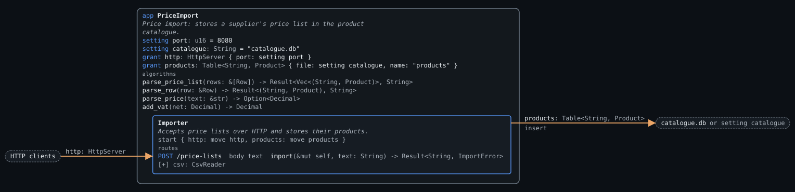
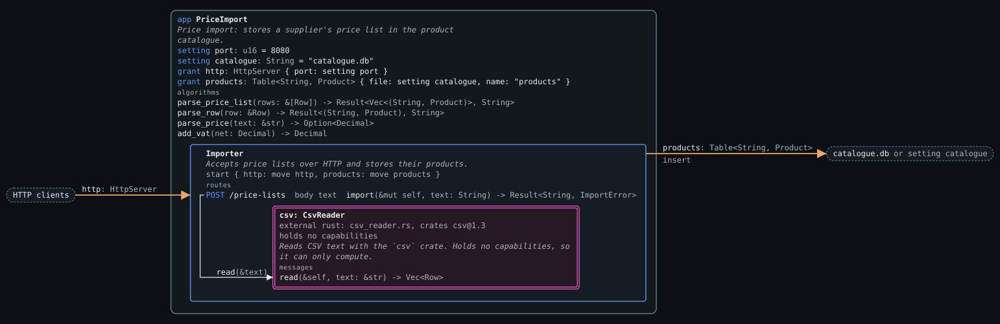
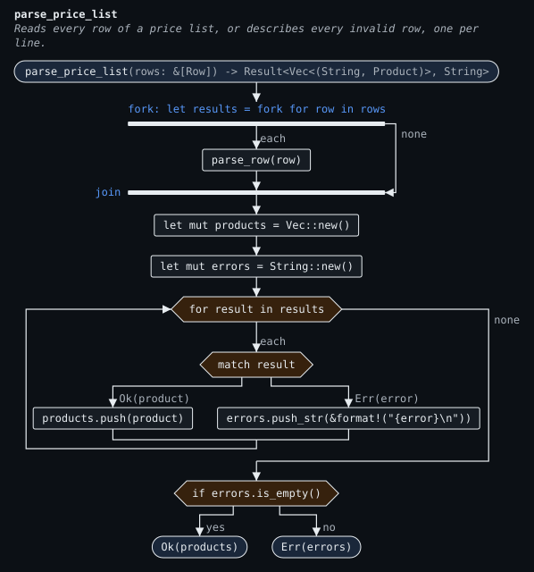
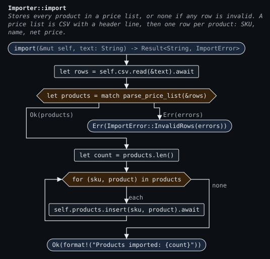

# CSV import

Stores a supplier's price list in a product catalogue. A client posts the price list as CSV to `POST /price-lists`. Each row gives a SKU, a product name and a net price, and the importer adds VAT before storing the product. If any row is invalid, nothing is stored, and the reply lists every invalid line.

```
sku,name,net
bolt-m6,M6 bolt,0.10
nut-m6,M6 nut,0.05
```

## Files

| File | Contents |
| --- | --- |
| `src/main.inset` | The app, the data types, the `CsvReader` declaration, the `Importer` component, and the algorithms |
| `src/csv_reader.rs` | The Rust that implements `CsvReader` with the `csv` crate, as a crate of its own |
| `inset.lock` | The exact version of each crate `csv_reader.rs` builds with, which `inset build` wrote and keeps to, in Cargo's lock-file format |
| `requirements/import.req.inset` | The requirement tests, written against the app's HTTP boundary |

## What it exercises

| Construct | Where |
| --- | --- |
| A file chosen at run time | `setting catalogue` lets whoever runs the import point it at the catalogue that other tools read. Compare the Stock tracker's fixed file |
| External Rust crate | `extern component CsvReader` declares the messages (`#[message] fn read`) and capabilities of a component written in Rust. `#[rust(...)]` names the file and the crate |
| The Rust side | `csv_reader.rs` implements the generated `interface::CsvReader` trait for its own `Reader` type and names it with `interface::export!`. It is built as a WebAssembly component of its own, so the host enforces that it holds no capabilities |
| Declared capabilities | `CsvReader` has no fields, so it holds no capabilities and can only compute |
| External component as a child | `Importer` starts it with `start csv: CsvReader {}` and sends it messages like any component |
| Structured concurrency | `fork for row in rows { ... }` in `parse_price_list` reads every row concurrently and joins the results in order. Each branch gives a `Result`, because a branch cannot `return` or change what the others see |
| Top-level algorithms | `parse_price_list`, `parse_row`, `parse_price` and `add_vat`, which take no `self` |
| Property tests | "Any net price ... is stored exactly" and "The gross price is never below the net price", which generate prices and post them in a price list. `inset test` runs each for 100 generated prices, the same ones every time |
| Examples table | The refused net prices, filled into a text block |
| Branch coverage of loops | "A price list with no products is accepted and stores nothing" runs the `fork` and the `for` with nothing to loop over, so the case of an empty list is a stated requirement, not an accident |
| Checks | `and products["bolt-m6"].gross >= <net>`, for a result a property cannot state exactly |
| External code tested from outside | "A field in quotes may contain commas" tests the `csv` crate's behaviour through the app |
| Text blocks in tests | The `"""` blocks holding a CSV body and a multi-line reply |
| Error replies with a body | `ImportError::InvalidRows(String)` replies `400 Bad Request` with the string as its body |

It covers the brief's CSV import row: an external Rust crate, structured concurrency, and property tests.

Every branch of the code is reached by some requirement, so `inset test examples/csv-import --coverage` reports nothing uncovered.

The gross price property only holds for whole numbers of pence. For a net price of `0.001`, VAT would round the gross price down to `0.00`. `parse_price` refuses such prices, and the property's `where` clause generates only whole pence.

## Expected diagrams

`expected/diagram.json` is the diagram data the compiler must emit, written by hand. The SVGs are drawn from it with `inset-diagram render` (see [diagrams.md](../../docs/language/diagrams.md)).

**Component view** (`expected/diagram.svg`). `Importer` is collapsed, and the app box lists the top-level algorithms.



**Inside `Importer`** (`expected/importer.svg`, with `--expand PriceImport/Importer`). The double-lined box is external: the reviewer sees its interface and its capabilities, which are none, but not its code.



**Flowchart of `parse_price_list`** (`expected/parse_price_list.svg`). The fork runs one branch per row, and the join waits for them all.



**Flowchart of `Importer::import`** (`expected/import.svg`):



- No component has a failure section, so any failure, such as a database error while storing products, stops the program. The reviewer can see that nothing is hidden.
- The only external system the program touches is `catalogue.db`, through `Importer`. The Rust code cannot reach it, because it holds nothing.
- The flowchart shows that rows are read independently, which is what makes reporting every invalid line possible.
