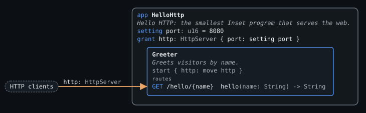
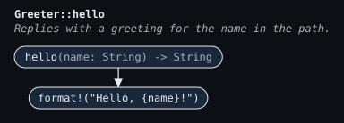

# Hello HTTP

A web server with one address. A request for `/hello/Ada` gets the text reply `Hello, Ada!`.

## Files

| File | Contents |
| --- | --- |
| `src/main.inset` | The app, which receives the network capability from the host, and the `Greeter` component it starts |
| `requirements/hello.req.inset` | The one requirement test |
| `expected/diagram.json` and `expected/*.svg` | The diagram the compiler must emit, and its pictures |

## What it exercises

| Construct | Where |
| --- | --- |
| App and host grant | `grant http: HttpServer { port }` asks the host for an HTTP server |
| Setting | `setting port: u16 = 8080` lets whoever runs the program choose the port, with 8080 as the default |
| Capability hand-down | `start Greeter { http: move http }` moves the capability into the component |
| Component | `Greeter`, whose fields list the only capability it holds |
| Route | `#[get("/hello/{name}", via = http)]` on `fn hello`, a handler for requests arriving through `http` |
| Reply | The function's value, `format!("Hello, {name}!")`, sent as `200 OK` text |
| Requirement test | One `when` / `then` test at the app's HTTP boundary |

It covers the brief's Hello HTTP row: one component, one route, one requirement test, and the network capability. It has no `given` step because the app is granted nothing that holds state.

## Expected diagram

`expected/diagram.json` is the diagram data the compiler must emit, written by hand. The SVGs are drawn from it with `inset-diagram render` (see [diagrams.md](../../docs/language/diagrams.md)). A test compares this file with the output of `inset diagram --json`, and compares the SVGs with pictures drawn by `inset diagram`.

**Component view** (`expected/diagram.svg`):

**Flowchart of `hello`** (`expected/hello.svg`, with `--flowchart HelloHttp/Greeter/fn:hello`):

- The grant is the only place a capability enters the program, so the reviewer sees every external access at the app boundary.
- The setting is listed with its default, so the reviewer sees what can change at run time.
- The request arrow from HTTP clients ends at the route it reaches, and the route's row shows the handler's reply type.
- The requirement test covers the route and its reply, so the coverage overlay should leave nothing uncovered.
