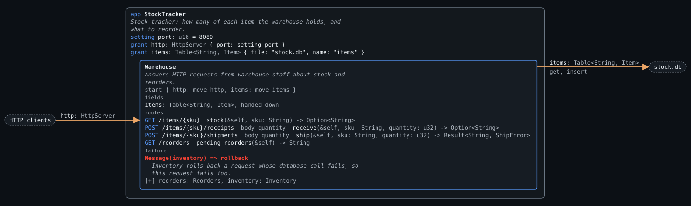
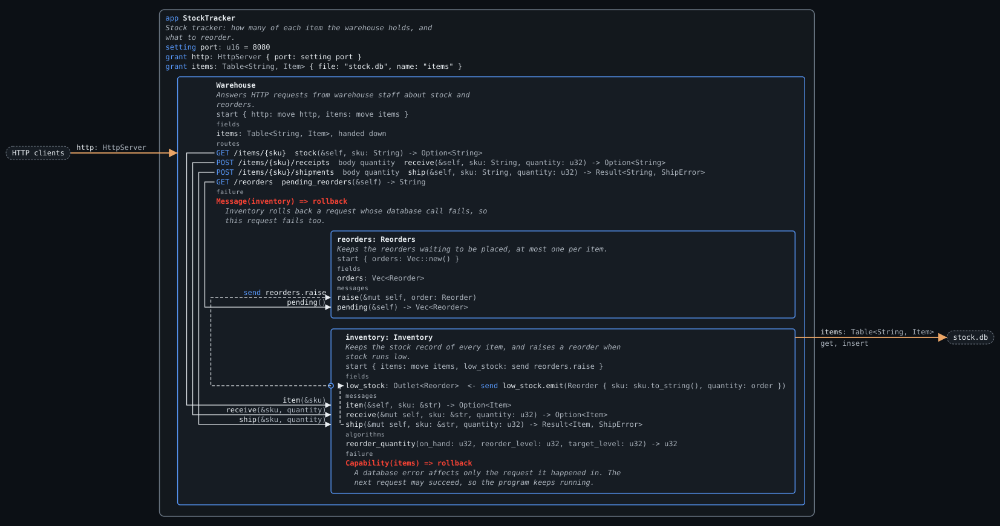
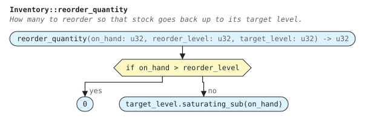
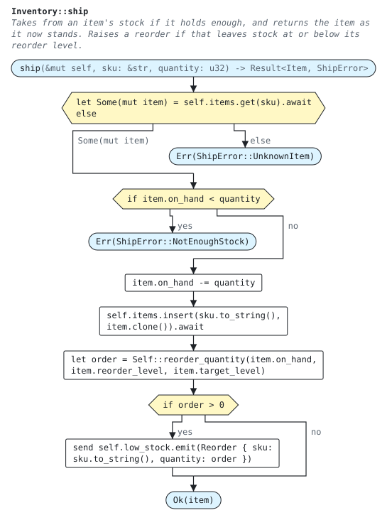

# Stock tracker

Tracks how many of each item a warehouse holds. Staff record stock that arrives and stock that is shipped, over HTTP. When shipping leaves an item at or below its reorder level, the tracker raises a reorder that brings it back up to its target level. A page in the browser lists the stock and stocks new items.

| Request | Reply |
| --- | --- |
| `GET /items?low=true` | Every item's stock as JSON, in SKU order. With `low=true`, only the items at or below their reorder level |
| `PUT /items/{sku}`, body an `Item` as JSON | The quantity on hand, or `400 Bad Request` if the body is not an item |
| `GET /items/{sku}` | The quantity on hand, or `404 Not Found` |
| `POST /items/{sku}/receipts`, body a quantity | The new quantity on hand, or `404 Not Found` |
| `POST /items/{sku}/shipments`, body a quantity | The new quantity on hand, `404 Not Found`, or `409 Conflict` if there is not enough stock |
| `GET /reorders` | One line per reorder waiting to be placed: the SKU, then the quantity |

## Files

| File | Contents |
| --- | --- |
| `src/main.inset` | The root module: the app, which is granted the network and the stock table, and the data types |
| `src/warehouse.inset` | The `warehouse` module: `Warehouse` and the two components nested in it, `Inventory` and `Reorders` |
| `requirements/stock.req.inset` | The requirement tests, written against the app's HTTP boundary |
| `web/` | The front end: `index.html`, `app.js` and `style.css`. `app.js` is JavaScript checked by `tsc` against the TypeScript types `inset build` writes to `target/inset/stock-tracker.d.ts` |

The program is split into two modules to show that Inset's modules are Rust's: `mod warehouse;` and `use warehouse::Warehouse;` in `main.inset`, `use crate::{Item, Reorder, ShipError};` and `pub component Warehouse` in `warehouse.inset`.

## What it exercises

| Construct | Where |
| --- | --- |
| Database capability | `grant items: Table<String, Item> { ... }` asks the host for a stored table |
| A fixed file and a setting | The stock database belongs to the tool alone, so its file is written in the grant. The port is a `setting` |
| Several actors | `Warehouse`, `Inventory` and `Reorders` each run as a component |
| Nested components | `Warehouse` starts `Reorders` and `Inventory` with `start` statements |
| An outlet | `Inventory` declares `low_stock: Outlet<Reorder>` and emits reorders through it, without naming who receives them. `Warehouse` connects it with `start inventory: Inventory { ..., low_stock: send reorders.raise }` |
| Capability hand-down | The app moves `items` into `Warehouse`, which marks the field `#[handed_down]` and moves it on into `Inventory`. Only `Inventory` uses it |
| Message handlers | `#[message]` on the functions of `Inventory` and `Reorders` |
| Messages that wait for a reply | `self.inventory.ship(&sku, quantity).await`, a call on a `Handle<Inventory>` |
| A message that does not wait | `send self.low_stock.emit(...)`, which reaches `Reorders` through the outlet |
| Boundary notation | `move` for capabilities, `&sku` for a lent string, a bare `quantity` for a copied number, and `Reorder { ... }` for a value built in place |
| Component state | `Reorders` holds its list of reorders in a field and changes it in `&mut self` handlers |
| Request bodies | `body = quantity` reads the request body as a `u32` |
| JSON bodies and replies | `stock_item` reads a `Json<Item>`, and `stock_levels` replies with a `Json<Vec<StockLevel>>`. `#[serde(rename_all = "camelCase")]` makes `on_hand` `onHand` in JSON |
| A query parameter | `GET /items?{low}`, with `low: Option<bool>`, so a request may leave it out |
| A front end | `front end via http calls [...]` in the app, with its files in `web/`, drawn as a box with an arrow to each route it calls |
| JSON in requirements | "Stock levels are listed in SKU order" compares a JSON reply with a value, and "An item is stocked with the levels it is given" sends one |
| Error replies | `Option` replies `404 Not Found` for `None`. `ShipError` names a status on each variant |
| Algorithm in a component | `Inventory::reorder_quantity`, which takes no `self` and so touches no capability |
| Examples table | "Stock that falls to its reorder level...", one row per case of reordering, which covers every branch of `reorder_quantity` from outside |
| Failure responses | `Inventory` rolls back a request whose database call fails, and `Warehouse` rolls back a request whose message to `Inventory` fails. Each arm gives its reason. Any other failure stops the program |
| Fault injection in tests | `and items fails` in "A database failure fails the request and changes nothing" |
| Closures and iterators | `iter_mut().find(...)` in `Reorders::raise`, and `map(...).collect()` in `pending_reorders` |
| Capability facts in tests | `given items["bolt-m6"] is Item { ... }` and `and items is empty` |
| Several requests in one test | "A new reorder for an item replaces its earlier one" |

It covers the brief's Stock tracker row: several actors, a database capability, an algorithm flowchart, and table tests (written as an examples table against the app).

## Running it

`inset test examples/stock-tracker` runs the requirements, with each row of the examples table on a line of its own. `inset run examples/stock-tracker` serves the program and its page at `http://localhost:8080/`, and keeps `stock.db` in the directory it is run from. `cargo xtask e2e stock-tracker` stocks an item through `PUT /items/{sku}` and checks the replies over HTTP. `cargo xtask contract` checks `web/app.js` against the TypeScript types, and checks that renaming `on_hand` in the Inset source makes that check fail.

No requirement names a component or an algorithm, yet every branch of the code is reached by some requirement, so the coverage overlay should leave nothing uncovered.

## Expected diagrams

`expected/diagram.json` is the diagram data the compiler must emit, written by hand. The SVGs are drawn from it with `inset-diagram render` (see [diagrams.md](../../docs/language/diagrams.md)). Solid arrows are messages that wait for a reply. Dashed arrows are messages sent without waiting, and outlet connections. A `○` on a box's edge is an outlet.

**Component view** (`expected/diagram.svg`). `Warehouse` is collapsed, so the `items` edge leaves from it. The front end is the box below the HTTP clients, with an arrow to each of the two routes it calls.

**Inside `Warehouse`** (`expected/warehouse.svg`, with `--expand StockTracker/Warehouse`). The reviewer expands it to see its children.

**Flowchart of `reorder_quantity`** (`expected/reorder_quantity.svg`):

**Flowchart of `Inventory::ship`** (`expected/ship.svg`), with every branch the requirements must reach:

- `items` enters at the app, passes through `Warehouse` without being used, and is used only by `Inventory`. The reviewer sees exactly one component touching the database.
- Messages go from a parent to its children. `Inventory` announces low stock through its `low_stock` outlet, drawn as the port `○` on its box, and `Warehouse` connects that port to `Reorders`. `Inventory` never names `Reorders`, and an outlet never waits, so the arrow cannot be part of a loop.
- Moving the reorder decision from `Warehouse` into `Inventory` changed no requirement, because requirements only see the app's boundary.
- The examples table reaches both branches of the flowchart through HTTP requests alone.
- `Inventory` and `Warehouse` each have a failure section: `Capability(items) => rollback` and `Message(inventory) => rollback`, each with its reason. `Reorders` has none, so the reviewer can see that any failure there stops the program.
